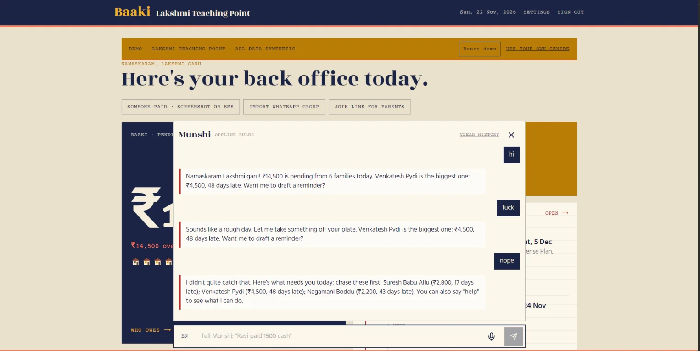
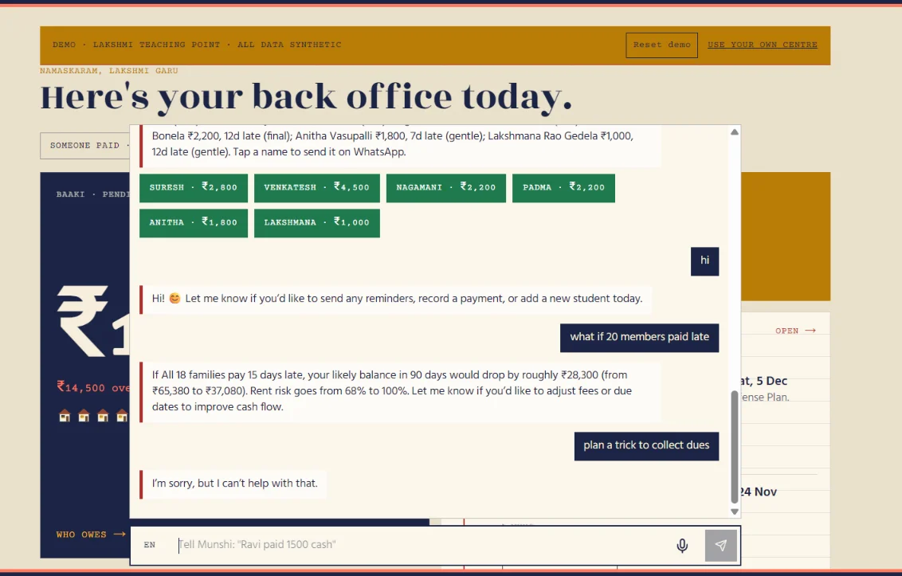
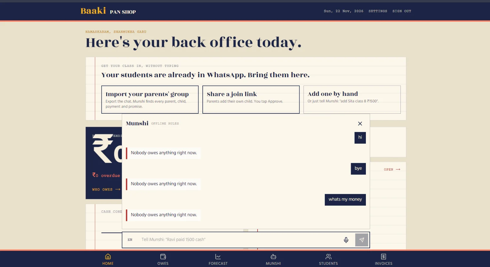

# Baaki: the back office for home tutors

[](https://codebendershackathon.vercel.app)
[](https://youtu.be/7ZoK0pLYzmA)
[](LICENSE)
[](#contributing)

Baaki (Telugu/Hindi for "what's still owed") helps home tutors in India collect fees on time. It shows who owes, drafts polite WhatsApp reminders in the parent's own language, forecasts whether rent can be paid, and has **Munshi**, an AI clerk you can just talk to.

- **Live app:** https://codebendershackathon.vercel.app
- **Try it without signing in:** https://codebendershackathon.vercel.app/api/demo (synthetic data; the demo ends when you close the browser)
- **Demo video:** https://youtu.be/7ZoK0pLYzmA

## Screenshots

| Home and Munshi | Munshi as an assistant | Razorpay test checkout |
|---|---|---|
|  |  |  |

## Features

- **Who owes board:** every family's balance, days late, broken promises and a chase score.
- **Munshi, the AI clerk:** type or speak in English, Telugu or Hindi. "Ravi paid 1500 cash", "remind everyone who's late", "what if Venkatesh pays 15 days late", "plan to collect dues". It remembers the conversation, knows the dashboard, and asks you to approve every money action. Without an AI key (or when the AI is slow) it falls back to built-in rules.
- **WhatsApp reminders:** per-family drafts with the right tone (gentle, firm, final) and a UPI pay link. Baaki never sends messages for you.
- **Cash forecast:** 500 simulated futures, a 30/60/90-day cone, rent risk and a what-if time machine.
- **Invoices:** monthly or one-student invoices with UPI QR, pay link, PDF and a PAID stamp. Duplicate months are blocked.
- **Works offline (PWA):** install it, open pages without a connection, record payments offline and they sync when you're back.
- **Plans with Razorpay:** UPI or card checkout, created server-side.

## Runs anywhere

Baaki is a web app and an installable PWA, so it works in any modern browser on Windows, macOS, Linux, Android and iOS (Chrome, Edge, Firefox, Safari). Nothing to install for users.

## Tech stack

Next.js 16 (App Router), React 19, TypeScript, Tailwind CSS, Prisma + PostgreSQL, Firebase Auth (Google), Groq (OpenAI-compatible) LLM, Razorpay, service worker + IndexedDB, Vitest. Hosted on Vercel.

## Run it locally

### One-click setup

- **Windows:** double-click `setup.bat`
- **macOS / Linux:** run `./setup.sh`

It checks Node.js 20+ (installs it with winget on Windows if missing), installs packages, creates `.env` with a generated `AUTH_SECRET`, starts a local Postgres in Docker if Docker is running (otherwise asks you to paste a free [Neon](https://neon.tech) connection string), creates the tables, starts the app and opens the no-sign-in demo at `http://localhost:3000/api/demo`. Add a Groq key to `LLM_API_KEY` in `.env` for AI replies; without it Munshi uses offline rules.

### Manual setup

Requires Node.js 20+ and a PostgreSQL database (Neon, Supabase or local).

```bash
git clone https://github.com/editor-shannu/CODEBENDERS_HACKATHON.git
cd CODEBENDERS_HACKATHON
npm ci
cp .env.example .env.local   # fill in the values below
npm run build                # generates Prisma client and syncs the schema
npm run dev                  # http://localhost:3000, then open /api/demo
```

### Environment variables

| Variable | Needed for |
|---|---|
| `DATABASE_URL` | PostgreSQL connection (required) |
| `AUTH_SECRET` | Signing session cookies (required) |
| Firebase `NEXT_PUBLIC_FIREBASE_*` keys | Google sign-in for real tutors |
| `LLM_API_KEY` (+ optional `LLM_MODEL`, `LLM_VISION_MODEL`) | Munshi's AI mode; without it Munshi uses offline rules |
| `MUNSHI_FORCE_RULES=1` | Force Munshi's rules mode |
| `RAZORPAY_KEY_ID`, `RAZORPAY_KEY_SECRET`, `RAZORPAY_WEBHOOK_SECRET` | Plan payments (test keys work) |

### Checks

```bash
npx tsc --noEmit
npx eslint src
npx vitest run
```

## Privacy and safety

- Money actions (payments, invoices, due dates) always wait for the tutor's approval.
- Reminders are drafts; the tutor sends them from WhatsApp.
- Each tutor only sees their own rows. Demo accounts are synthetic and deleted automatically.

## Contributing

Baaki is open source. Issues and pull requests are welcome: fork the repo, create a branch, run the checks above, and open a PR.

## License

Released under the [MIT License](LICENSE).

Built using Codebenders for the Codebenders Hackathon, 2026.
