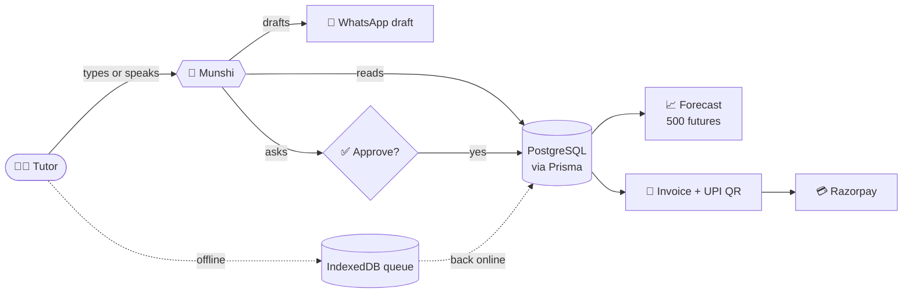
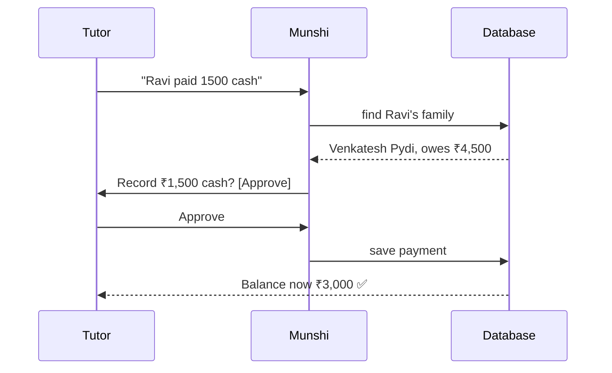

<div align="center">

# 🪙 Baaki

### The one-person back office for home tutors

*Baaki* (Telugu/Hindi for **"what's still owed"**) shows who owes, drafts the WhatsApp reminder in the parent's own language, forecasts whether rent is safe, and gives you **Munshi**, an AI clerk you can just talk to.

[](https://codebendershackathon.vercel.app)
[](https://codebendershackathon.vercel.app/api/demo)
[](https://youtu.be/7ZoK0pLYzmA)

[](LICENSE)
[](#-contributing)


[Problem](#-the-problem) · [Tour](#-60-second-tour) · [Munshi](#-talk-to-munshi) · [Features](#-features) · [How it works](#-how-it-works) · [Run locally](#-run-it-locally-in-one-click) · [FAQ](#-faq)

</div>

---

## 😩 The problem

A home tutor in Andhra Pradesh teaches 18 kids. Fees come in cash, PhonePe, GPay, half now and half "next week". Rent is due on the 1st. Chasing parents feels awkward, a notebook *khata* gets lost, and nobody can say **"will I make rent this month?"**

**Baaki turns that notebook into a calm, private back office that fits in one hand.**

---

## 🎬 60-second tour

> Click any step to expand it, or just [open the demo](https://codebendershackathon.vercel.app/api/demo) and follow along.

<details>
<summary><b>1️⃣ See who owes, at a glance</b></summary>

<br>

The Home board shows every family's balance, days late, broken promises and a **chase score**, so you know who to call first.


</details>

<details>
<summary><b>2️⃣ Tell Munshi what happened</b></summary>

<br>

Type or speak: <code>Ravi paid 1500 cash</code>. Munshi finds Ravi Teja's father, Venkatesh Pydi, and asks you to **Approve**. Balance drops from ₹4,500 to ₹3,000.


</details>

<details>
<summary><b>3️⃣ Send reminders that don't feel awkward</b></summary>

<br>

<code>Remind everyone who's late</code> gives one WhatsApp draft per family, gentle, firm or final, in Telugu, Hindi or English, with a UPI pay link. You tap send. Baaki never messages anyone on its own.

</details>

<details>
<summary><b>4️⃣ Ask "will I make rent?"</b></summary>

<br>

500 simulated futures produce a 30/60/90-day cash cone and a rent-risk score. Then play with the **what-if time machine**: <code>What if Venkatesh pays 15 days late?</code>

</details>

<details>
<summary><b>5️⃣ Invoice and get paid</b></summary>

<br>

One-tap invoices with a UPI QR, pay link and PDF. Duplicate months are blocked. Plans are paid through Razorpay (test mode in the demo).


</details>

---

## 💬 Talk to Munshi

Munshi is a clerk, not a chatbot. It knows your dashboard, remembers the conversation, and **never moves money without your approval**. Copy any of these into the demo:

| You say | Munshi does |
|---|---|
| `Ravi paid 1500 cash` | Finds the family, records it after you approve |
| `Who owes me the most?` | Ranks families by balance |
| `Remind everyone who's late` | Drafts WhatsApp messages with the right tone |
| `What if Venkatesh pays 15 days late?` | Re-runs the forecast and shows the change |
| `Plan to collect dues this week` | Builds a who-to-call-when plan |
| `Make an invoice for Venkatesh` | Creates a one-student invoice with UPI QR |

<details>
<summary>🧠 What if there's no AI key or no internet?</summary>

<br>

Munshi falls back to built-in rules, so the core commands above still work. With a Groq key it answers in full sentences and handles follow-ups like "and him?" or "nope, 2000".

</details>

---

## ✨ Features

<table>
<tr>
<td width="50%" valign="top">

### 📋 Who-owes board
Balance, days late, broken promises and chase score for every family.

### 🤖 Munshi, the AI clerk
English, Telugu, Hindi. Voice or text. Remembers context. Approval before any money action.

### 📲 WhatsApp reminders
Gentle, firm or final drafts with a UPI pay link. You send, Baaki never does.

</td>
<td width="50%" valign="top">

### 📈 Cash forecast
500 simulated futures, 30/60/90-day cone, rent risk and a what-if time machine.

### 🧾 Invoices
Monthly or one-student, with UPI QR, pay link, PDF and a PAID stamp.

### 📴 Works offline
Installable PWA. Record payments offline; they sync when you're back.

### 💳 Razorpay plans
UPI or card checkout, created server-side.

</td>
</tr>
</table>

---

## 🧩 How it works





**Stack:** Next.js 16 (App Router) · React 19 · TypeScript · Tailwind CSS · Prisma + PostgreSQL · Firebase Auth · Groq LLM (OpenAI-compatible) · Razorpay · Service worker + IndexedDB · Vitest · Vercel

---

## 🚀 Run it locally in one click

<details open>
<summary><b>🪟 Windows</b></summary>

<br>

1. Clone or download this repo.
2. **Double-click `setup.bat`.**
3. The demo opens at `http://localhost:3000/api/demo`.

</details>

<details>
<summary><b>🍎 macOS / 🐧 Linux</b></summary>

<br>

```bash
git clone https://github.com/editor-shannu/CODEBENDERS_HACKATHON.git
cd CODEBENDERS_HACKATHON
./setup.sh
```

</details>

<details>
<summary><b>🔍 What the setup script does</b></summary>

<br>

- [x] Checks for Node.js 20+ (installs it with winget on Windows if missing)
- [x] Installs packages
- [x] Creates `.env` and generates `AUTH_SECRET`
- [x] Starts Postgres in Docker if Docker is running, otherwise asks for a free [Neon](https://neon.tech) connection string
- [x] Creates the database tables
- [x] Starts the app and opens the no-sign-in demo

Add a Groq key to `LLM_API_KEY` in `.env` for AI replies. Without it Munshi uses offline rules.

</details>

<details>
<summary><b>🛠️ Manual setup</b></summary>

<br>

Requires Node.js 20+ and a PostgreSQL database (Neon, Supabase or local).

```bash
git clone https://github.com/editor-shannu/CODEBENDERS_HACKATHON.git
cd CODEBENDERS_HACKATHON
npm ci
cp .env.example .env   # fill in the values below
npm run build          # generates Prisma client and syncs the schema
npm run dev            # http://localhost:3000, then open /api/demo
```

| Variable | Needed for |
|---|---|
| `DATABASE_URL` | PostgreSQL connection (required) |
| `AUTH_SECRET` | Signing session cookies (required) |
| `NEXT_PUBLIC_FIREBASE_*` | Google sign-in for real tutors (not needed for the demo) |
| `LLM_API_KEY` (+ optional `LLM_MODEL`, `LLM_VISION_MODEL`) | Munshi's AI mode |
| `MUNSHI_FORCE_RULES=1` | Force Munshi's rules mode |
| `RAZORPAY_KEY_ID`, `RAZORPAY_KEY_SECRET`, `RAZORPAY_WEBHOOK_SECRET` | Plan payments (test keys work) |

**Checks**

```bash
npx tsc --noEmit
npx eslint src
npx vitest run
```

</details>

---

## 🌍 Runs anywhere

Baaki is a web app and an installable PWA, so it opens in any modern browser on Windows, macOS, Linux, Android and iOS. Nothing for tutors to install.

---

## 🔒 Privacy and safety

- ✅ Money actions always wait for the tutor's approval
- ✅ Reminders are drafts; the tutor sends them from WhatsApp
- ✅ Each tutor only sees their own rows
- ✅ Demo data is synthetic and deleted automatically

---

## ❓ FAQ

<details>
<summary>Do I need to sign in to try it?</summary>
<br>
No. Open <a href="https://codebendershackathon.vercel.app/api/demo">/api/demo</a> for a sandbox with 18 synthetic families. It ends when you close the browser.
</details>

<details>
<summary>Does Baaki send WhatsApp messages automatically?</summary>
<br>
Never. It writes the draft and opens WhatsApp; the tutor presses send.
</details>

<details>
<summary>Will payments in the demo charge my card?</summary>
<br>
No. Razorpay runs in test mode in the demo.
</details>

<details>
<summary>What does "Munshi" mean?</summary>
<br>
A <i>munshi</i> is the traditional clerk who kept the accounts. Ours just happens to live in your phone.
</details>

---

## 🤝 Contributing

Baaki is open source. Fork the repo, create a branch, run the checks, and open a pull request. Issues and ideas are welcome.

## 📄 License

Released under the [MIT License](LICENSE).

<div align="center">

<br>

**Built with ❤️ using Codebenders for the Codebenders Hackathon 2026**

⭐ If Baaki would help a tutor you know, star the repo!

</div>
